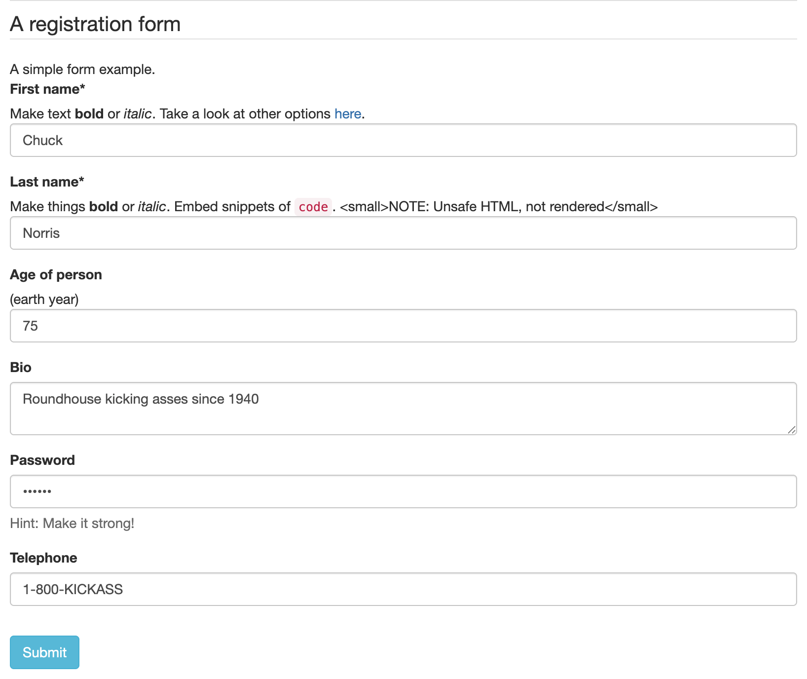

[![Build Status][build-shield]][build-url]
[![npm][npm-shield]][npm-url]
[![npm downloads][npm-dl-shield]][npm-dl-url]
[![Contributors][contributors-shield]][contributors-url]
[![Apache 2.0 License][license-shield]][license-url]

<br />
<p align="center">
  <a href="https://github.com/rjsf-team/react-jsonschema-form">
    
  </a>

  <h3 align="center">@rjsf/core</h3>

  <p align="center">
  Core logic and unstyled default theme for <a href="https://github.com/rjsf-team/react-jsonschema-form/"><code>react-jsonschema-form</code></a>.
    <br />
    <a href="https://rjsf-team.github.io/react-jsonschema-form/docs/"><strong>Explore the docs »</strong></a>
    <br />
    <br />
    <a href="https://rjsf-team.github.io/react-jsonschema-form/">View Playground</a>
    ·
    <a href="https://github.com/rjsf-team/react-jsonschema-form/issues">Report Bug</a>
    ·
    <a href="https://github.com/rjsf-team/react-jsonschema-form/issues">Request Feature</a>
  </p>
</p>

<!-- TABLE OF CONTENTS -->

## Table of Contents

- [Table of Contents](#table-of-contents)
- [About The Project](#about-the-project)
  - [Built With](#built-with)
- [Getting Started](#getting-started)
  - [Prerequisites](#prerequisites)
  - [Installation](#installation)
- [Usage](#usage)
- [Roadmap](#roadmap)
- [Contributing](#contributing)
- [Contact](#contact)

<!-- ABOUT THE PROJECT -->

## About The Project

Core logic and the unstyled default theme for `react-jsonschema-form`: toolkit-independent HTML5 markup carrying `rjsf-` marker classes, and an optional stylesheet, `@rjsf/core/rjsf.css`, that styles it with HTML5 and CSS3 alone.

[](https://rjsf-team.github.io/@rjsf/core)

### Built With

- [react-jsonschema-form](https://github.com/rjsf-team/react-jsonschema-form/)

<!-- GETTING STARTED -->

## Getting Started

### Prerequisites

None: the form renders the browser's own controls. To style them without a CSS framework, import the optional stylesheet:

```js
import '@rjsf/core/rjsf.css';
```

The Bootstrap 3 markup `@rjsf/core` rendered through v6 is the deprecated [`@rjsf/bootstrap3`](../bootstrap3) package.

### Installation

```sh
npm install @rjsf/core
```

## Usage

```javascript
import Form from '@rjsf/core';
```

<!-- ROADMAP -->

## Roadmap

See the general [open issues](https://github.com/rjsf-team/react-jsonschema-form/issues).

<!-- CONTRIBUTING -->

## Contributing

Read our [contributors' guide](https://rjsf-team.github.io/react-jsonschema-form/docs/contributing/) to get started.

<!-- CONTACT -->

## Contact

rjsf team: [https://github.com/orgs/rjsf-team/people](https://github.com/orgs/rjsf-team/people)

GitHub repository: [https://github.com/rjsf-team/react-jsonschema-form](https://github.com/rjsf-team/react-jsonschema-form)

<!-- MARKDOWN LINKS & IMAGES -->
<!-- https://www.markdownguide.org/basic-syntax/#reference-style-links -->

[build-shield]: https://github.com/rjsf-team/react-jsonschema-form/workflows/CI/badge.svg
[build-url]: https://github.com/rjsf-team/react-jsonschema-form/actions
[contributors-shield]: https://img.shields.io/github/contributors/rjsf-team/react-jsonschema-form.svg
[contributors-url]: https://github.com/rjsf-team/react-jsonschema-form/graphs/contributors
[license-shield]: https://img.shields.io/badge/license-Apache%202.0-blue.svg?style=flat-square
[license-url]: https://choosealicense.com/licenses/apache-2.0/
[npm-shield]: https://img.shields.io/npm/v/@rjsf/core/latest.svg?style=flat-square
[npm-url]: https://www.npmjs.com/package/@rjsf/core
[npm-dl-shield]: https://img.shields.io/npm/dm/@rjsf/core.svg?style=flat-square
[npm-dl-url]: https://www.npmjs.com/package/@rjsf/core
[product-screenshot]: https://raw.githubusercontent.com/rjsf-team/react-jsonschema-form/59a8206e148474bea854bbb004f624143fbcbac8/packages/core/screenshot.png
