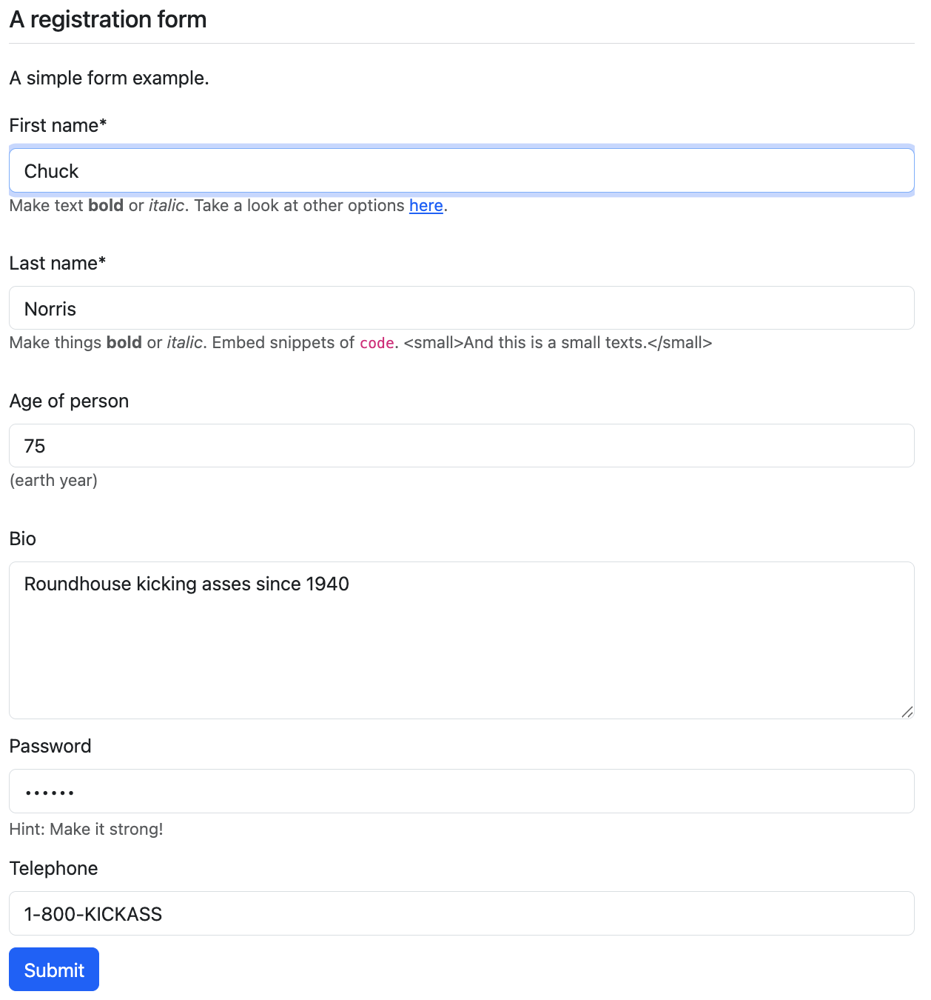

<!-- PROJECT LOGO -->
<br />
<p align="center">
  <a href="https://github.com/rjsf-team/react-jsonschema-form">
    
  </a>

  <h3 align="center">@rjsf/react-bootstrap</h3>

  <p align="center">
  Bootstrap 5 theme, fields and widgets for <a href="https://github.com/mozilla-services/react-jsonschema-form/"><code>react-jsonschema-form</code></a>.
    <br />
    <a href="https://rjsf-team.github.io/react-jsonschema-form/docs/"><strong>Explore the docs »</strong></a>
    <br />
    <br />
   <a href="https://rjsf-team.github.io/react-jsonschema-form/">View Playground</a>
    ·
    <a href="https://github.com/rjsf-team/react-jsonschema-form/issues">Report Bug</a>
    ·
    <a href="https://github.com/rjsf-team/react-jsonschema-form/issues">Request Feature</a>
  </p>
</p>

<!-- TABLE OF CONTENTS -->

## Table of Contents

- [Table of Contents](#table-of-contents)
- [About The Project](#about-the-project)
  - [Built With](#built-with)
- [Getting Started](#getting-started)
  - [Prerequisites](#prerequisites)
  - [Installation](#installation)
- [Usage](#usage)
- [Contributing](#contributing)
- [Contact](#contact)

<!-- ABOUT THE PROJECT -->

## About The Project

Exports `react-bootstrap` theme, fields and widgets for `react-jsonschema-form`.

[](https://rjsf-team.github.io/react-jsonschema-form/)

### Built With

- [react-jsonschema-form](https://github.com/mozilla-services/react-jsonschema-form/)
- [Bootstrap-5](https://getbootstrap.com/docs/5.3/)
- [TypeScript](https://www.typescriptlang.org/)

<!-- GETTING STARTED -->

## Getting Started

### Prerequisites

- `react-bootstrap >= 2.0.0`
- `@rjsf/core >= 7`
- `@rjsf/utils >= 7`
- `@rjsf/validator-ajv8 >= 7`

```bash
yarn add react-bootstrap @rjsf/core @rjsf/utils @rjsf/validator-ajv8
```

### Installation

```bash
yarn add @rjsf/react-bootstrap
```

## Usage

```js
import Form from '@rjsf/react-bootstrap';
```

or

```js
import { withTheme } from '@rjsf/core';
import { Theme as BootstrapTheme } from '@rjsf/react-bootstrap';

const Form = withTheme(BootstrapTheme);
```

<!-- CONTRIBUTING -->

## Contributing

Read our [contributors' guide](https://rjsf-team.github.io/react-jsonschema-form/docs/contributing/) to get started.

<!-- CONTACT -->

## Contact

rjsf team: [https://github.com/orgs/rjsf-team/people](https://github.com/orgs/rjsf-team/people)

GitHub repository: [https://github.com/rjsf-team/react-jsonschema-form](https://github.com/rjsf-team/react-jsonschema-form)
